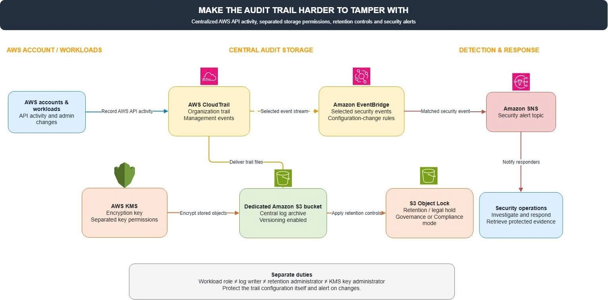

# If an Intruder Can Delete the Logs, What Is Left to Investigate With?

**Published on AWS Study Group:** [Read original Facebook post](https://www.facebook.com/groups/awsstudygroupfcj/posts/2330733614358264)

After a security incident, the question is not only "what happened?" but also "can we trust the data we use to answer that question?". If logs live in the same account, under the same administrative permissions, and can be modified or deleted by the very workload that has been compromised, the investigation trail can disappear exactly when we need it most.

Centralized logging is necessary, but centralization alone is not enough. We also need to separate log-writing permissions from system administration permissions, and have a mechanism to protect the stored data.

**Proposed Architecture**

* AWS CloudTrail records API activity in the account and delivers logs to a dedicated Amazon S3 bucket.
* The log bucket lives in a separate archive account or is managed by the security team, and does not share administrative permissions with the workload.
* Enable S3 Versioning and configure S3 Object Lock with a retention mode that matches your compliance requirements.
* Use AWS KMS to manage encryption keys, with key management permissions separated from log read and write permissions.
* Amazon EventBridge receives events of interest, such as changes to the audit configuration or sensitive administrative actions.
* EventBridge forwards these signals to Amazon SNS or a response workflow to alert the operations team.
* Amazon CloudWatch is used for application logs and operational alarms, while CloudTrail remains the audit source for AWS API activity.

**Immutable Does Not Mean Everything Is Automatically Safe**

S3 Object Lock must be configured correctly from the start. Governance mode allows principals with special permissions to bypass retention. Compliance mode is much stricter, but it also needs careful thought because data may not be deletable before the retention period ends. The retention period must balance legal requirements, storage costs, and operational processes.

The audit configuration path must be protected as well. If someone can turn off CloudTrail, change the destination bucket, or modify storage permissions without being detected, the system still has a blind spot.

**What Needs Verification?**

* Generate a test AWS API activity and confirm that CloudTrail records the event in the destination bucket.
* Use the application role to try deleting or modifying a log object, and confirm the action is denied as configured.
* Test retention and Object Lock with a test object, not with production logs.
* Change the audit configuration in a test environment and confirm that an alert is raised.
* Verify that log read permissions, log write permissions, retention management permissions, and KMS key management permissions are separated.
* Test the process for restoring and retrieving logs when an investigation is needed.

Logs do not prevent incidents from happening. But trustworthy logs mean you do not have to investigate an incident using traces that the intruder may have already deleted.

*Note: This is a proposed architecture and testing design, not the result of an actual production deployment.*

#AWS #CloudTrail #S3ObjectLock #KMS #IncidentResponse #SecurityLogging

