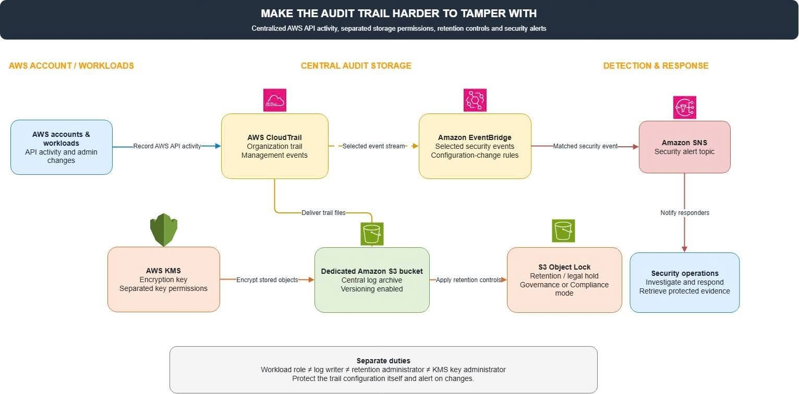

# Nếu kẻ xâm nhập xóa được log, bạn còn điều tra bằng gì?

**Đăng trên AWS Study Group:** [Xem bài viết gốc trên Facebook](https://www.facebook.com/groups/awsstudygroupfcj/posts/2330733614358264)

Sau một sự cố bảo mật, câu hỏi không chỉ là “đã có chuyện gì xảy ra?” mà còn là “mình có tin được dữ liệu dùng để trả lời câu hỏi đó không?”. Nếu log nằm chung tài khoản, chung quyền quản trị, và có thể bị sửa hoặc xóa bởi chính workload đang bị xâm nhập, thì dấu vết điều tra có thể biến mất đúng lúc ta cần nhất.

Log tập trung là cần thiết, nhưng tập trung thôi thì chưa đủ. Ta còn phải tách quyền ghi log khỏi quyền quản trị hệ thống, và có cơ chế bảo vệ dữ liệu lưu trữ.

**Kiến trúc đề xuất**

* AWS CloudTrail ghi lại hoạt động API trong tài khoản và gửi log về một Amazon S3 bucket chuyên dụng.
* Bucket log nằm ở một tài khoản lưu trữ riêng hoặc do nhóm bảo mật quản lý, không dùng chung quyền quản trị với workload.
* Bật S3 Versioning và cấu hình S3 Object Lock theo chế độ retention phù hợp với yêu cầu tuân thủ.
* Dùng AWS KMS để quản lý khóa mã hóa, với quyền quản lý khóa tách khỏi quyền đọc và ghi log.
* Amazon EventBridge nhận các sự kiện đáng quan tâm, chẳng hạn thay đổi cấu hình audit hoặc hành động quản trị nhạy cảm.
* EventBridge chuyển tín hiệu đến Amazon SNS hoặc một quy trình phản ứng để cảnh báo đội vận hành.
* Amazon CloudWatch dùng cho log ứng dụng và cảnh báo vận hành, còn CloudTrail vẫn là nguồn audit cho hoạt động AWS API.

**Bất biến không có nghĩa là mọi thứ tự động an toàn**

S3 Object Lock cần được cấu hình đúng ngay từ đầu. Chế độ Governance cho phép những principal có quyền đặc biệt bỏ qua retention. Chế độ Compliance chặt hơn nhiều, nhưng cũng cần cân nhắc kỹ vì dữ liệu có thể không xóa được trước thời hạn. Retention period phải cân bằng giữa yêu cầu pháp lý, chi phí lưu trữ và quy trình vận hành.

Ngoài ra, cũng phải bảo vệ cả đường cấu hình audit. Nếu có ai đó tắt được CloudTrail, đổi bucket đích hoặc sửa quyền lưu trữ mà không bị phát hiện, hệ thống vẫn còn một điểm mù.

**Cần kiểm chứng điều gì?**

* Tạo một hoạt động AWS API thử nghiệm và xác nhận CloudTrail ghi lại sự kiện trong bucket đích.
* Dùng role của ứng dụng thử xóa hoặc sửa object log, xác nhận quyền bị từ chối theo cấu hình.
* Kiểm tra retention và Object Lock bằng một object thử nghiệm, không dùng log sản xuất.
* Thử thay đổi cấu hình audit trong môi trường kiểm thử và xác nhận cảnh báo được phát ra.
* Xác minh quyền đọc log, quyền ghi log, quyền quản lý retention và quyền quản lý KMS key được tách biệt.
* Kiểm tra quy trình khôi phục và truy xuất log khi cần điều tra.

Log không ngăn được sự cố xảy ra. Nhưng log đáng tin cậy giúp bạn không phải điều tra một vụ việc bằng những dấu vết mà chính kẻ xâm nhập có thể đã xóa.

*Lưu ý: đây là kiến trúc và thiết kế kiểm thử đề xuất, chưa phải kết quả triển khai thực tế.*

#AWS #CloudTrail #S3ObjectLock #KMS #IncidentResponse #SecurityLogging

