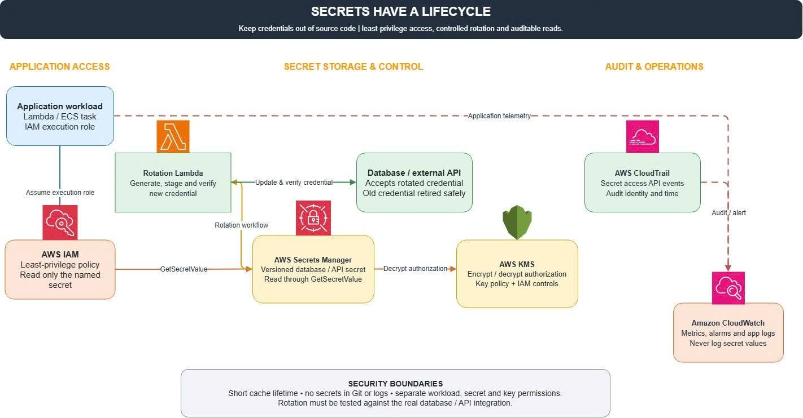

# Passwords in Source Code: Convenient Once, Costly Many Times

**Published on AWS Study Group:** [Read original Facebook post](https://www.facebook.com/groups/awsstudygroupfcj/posts/2331503327614626)

Every backend developer has been tempted by this "time-saving" shortcut: leaving API keys, database passwords, or service tokens in a configuration file and committing it to Git. It works, it deploys fast, and the whole team knows where to find it. Until the day the repository is shared by mistake, CI/CD logs leak, or an old credential is still valid long after the person holding it has left the project.

The problem is not just that a secret gets exposed. What is more worrying is that secrets often live too long, are readable by too many components, and have no clear revocation process.

**How to Solve This?**

We can manage the secret lifecycle with AWS services:

* Applications running on AWS Lambda or Amazon ECS use their own IAM Role instead of embedding long-term access keys in source code.
* Database and third-party API credentials are stored in AWS Secrets Manager.
* AWS KMS encrypts secrets at rest, and read access to secrets is restricted with IAM policies, so each workload reads only what it needs.
* The application retrieves secrets when needed and can cache them for a short time to avoid calling Secrets Manager on every request.
* For secrets that support rotation, configure a rotation workflow that replaces the credential, updates where it is used, and verifies the connection before completing.
* CloudTrail records the related API activity, in case an unusual access needs to be investigated.

**Points to Be Careful About**

Rotation does not automatically make every application safer. If an application reads a secret only once at startup and keeps it in memory forever, rotating the secret can cause new connections to fail. You need to decide when to refresh, how long to cache, and how to handle the old credential being revoked.

Also, do not grant `secretsmanager:GetSecretValue` to every role in the account. Each workload should read only its own secret. And secrets should never appear in logs, exception messages, or pipeline output.

**What Needs Verification?**

* Scan the repository and build artifacts to make sure no sample secrets or real credentials remain.
* Check that a workload can read only the secrets it has been granted: try reading a different secret and confirm the request is denied.
* Run rotation in a test environment and confirm the application picks up the new credential.
* Review CloudTrail to see which principal read a secret and when.
* Confirm that secrets are not written to application logs, for both successful and failed requests.

A good secret is not one hidden carefully in a file. It is one with narrow access that can be rotated and revoked.

*Note: This is a proposed architecture and testing design, not the result of an actual production deployment.*

#AWS #SecretsManager #KMS #IAM #CloudSecurity #DevSecOps

