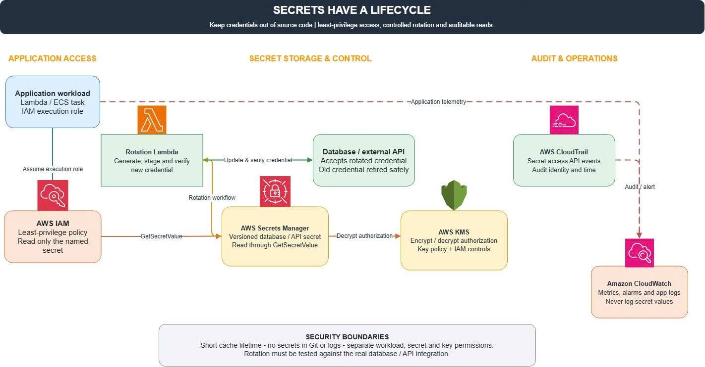

# Mật khẩu nằm trong source code: tiện một lần, trả giá nhiều lần

**Đăng trên AWS Study Group:** [Xem bài viết gốc trên Facebook](https://www.facebook.com/groups/awsstudygroupfcj/posts/2331503327614626)

Làm backend, ai cũng từng bị cám dỗ bởi cách “tiết kiệm thời gian” này: để luôn API key, mật khẩu database hay token dịch vụ trong file cấu hình rồi commit lên Git. Chạy được, deploy nhanh, cả team đều biết lấy ở đâu. Cho đến ngày repository bị chia sẻ nhầm, log CI/CD lộ ra, hoặc một credential cũ vẫn còn hiệu lực dù người giữ nó đã rời dự án từ lâu.

Vấn đề không chỉ là secret bị lộ. Cái đáng ngại hơn là secret thường sống quá lâu, bị quá nhiều thành phần đọc được, và chẳng có quy trình thu hồi rõ ràng nào.

**Giải quyết thế nào?**

Ta có thể quản lý vòng đời secret bằng các dịch vụ AWS:

* Ứng dụng chạy trên AWS Lambda hoặc Amazon ECS và dùng IAM Role riêng, thay vì nhúng access key dài hạn vào source code.
* Credential của database hoặc API bên thứ ba được lưu trong AWS Secrets Manager.
* AWS KMS mã hóa secret khi lưu trữ, còn quyền đọc secret được giới hạn bằng IAM policy, mỗi workload chỉ đọc đúng thứ nó cần.
* Ứng dụng lấy secret khi cần và có thể cache trong thời gian ngắn, để khỏi gọi Secrets Manager ở mọi request.
* Với secret hỗ trợ rotation, cấu hình rotation workflow để thay credential, cập nhật nơi sử dụng và kiểm tra kết nối trước khi hoàn tất.
* CloudTrail ghi lại các hoạt động API liên quan, phòng khi cần điều tra một lần truy cập bất thường.

**Những điểm cần cẩn thận**

Rotation không tự nhiên làm mọi ứng dụng an toàn hơn. Nếu ứng dụng chỉ đọc secret một lần lúc khởi động rồi giữ mãi trong bộ nhớ, việc xoay secret có thể khiến các kết nối mới thất bại. Bạn cần xác định khi nào thì refresh, cache bao lâu, và xử lý ra sao khi credential cũ bị thu hồi.

Cũng đừng cấp quyền `secretsmanager:GetSecretValue` cho toàn bộ role trong tài khoản. Mỗi workload chỉ nên đọc đúng secret của mình. Và secret không nên xuất hiện trong log, exception message hay output của pipeline.

**Cần kiểm chứng điều gì?**

* Quét repository và artifact build để chắc chắn không còn secret mẫu hay credential thật.
* Kiểm tra workload chỉ đọc được secret được cấp quyền: thử đọc một secret khác và xác nhận bị từ chối.
* Chạy rotation trong môi trường thử nghiệm, xác nhận ứng dụng lấy được credential mới.
* Xem CloudTrail để biết được principal nào đọc secret và vào lúc nào.
* Xác nhận secret không bị ghi vào application log, cả khi request thành công lẫn thất bại.

Một secret tốt không phải là secret được giấu kỹ trong một file. Đó là secret có quyền truy cập hẹp, xoay vòng được và thu hồi được.

*Lưu ý: đây là kiến trúc và thiết kế kiểm thử đề xuất, chưa phải kết quả triển khai thực tế.*

#AWS #SecretsManager #KMS #IAM #CloudSecurity #DevSecOps

