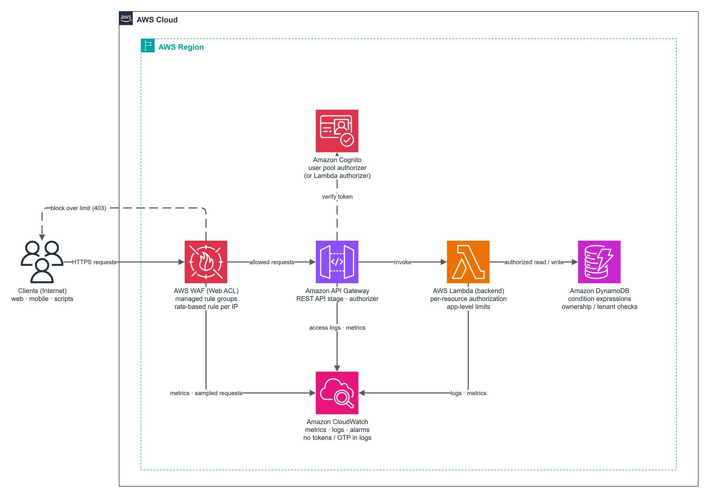

# A Public API Doesn't Mean Anyone Can Call It as Often as They Want

**Published on AWS Study Group:** [Read original Facebook post](https://www.facebook.com/groups/awsstudygroupfcj/posts/2339564356808523)

A public API has to be reachable from the Internet. But public does not mean the backend must accept unlimited requests from a single client, a single IP, or a group of abnormal requests.

Imagine a sign-in endpoint or an endpoint that sends verification codes. A client can send requests nonstop, driving up costs, overloading the backend, or making the service hard to use for real users. If you rely only on the frontend to limit how many times a button can be clicked, anyone can still call the API directly.

**How to Solve This?**

A protection layer at the edge can be built as follows:

* The client sends requests to Amazon API Gateway.
* AWS WAF is attached to the API Gateway stage to evaluate requests against a Web ACL.
* WAF applies suitable managed rule groups, together with a rate-based rule that limits traffic exceeding a threshold within a time window.
* API Gateway uses a suitable authorizer, such as Amazon Cognito or a Lambda authorizer, to authenticate users on endpoints that require sign-in.
* The backend Lambda still checks permissions on each resource, because successful authentication does not replace authorization.
* Amazon CloudWatch collects metrics and logs to monitor blocked requests, errors, and unusual traffic spikes.

**Rate Limiting Is Not an Absolute Shield**

A WAF rate-based rule is only a mitigation layer, not a promise that every attack will be blocked. A threshold that is too low blocks real users by mistake; one that is too high is almost useless. An IP also does not always correspond to one person, especially when many users share the same NAT network.

For sensitive endpoints such as sign-in, sending OTPs, or password recovery, combine multiple signals: IP, authenticated identity, per-account behavior, and application-level limits. Also, do not write tokens, passwords, or OTP codes to logs for analysis.

**What Needs Verification?**

* Send requests at a normal rate and confirm that legitimate users can still access the service.
* Generate test traffic above the threshold in a controlled environment and confirm that WAF starts applying the configured action.
* Review metrics and logs to distinguish requests that were allowed, blocked by WAF, and rejected by the backend.
* Have several users share one IP to assess the risk of false blocks.
* Confirm that endpoints requiring sign-in still reject requests with a missing or invalid token.
* Check that the backend still has its own authorization and does not treat WAF as a data authorization mechanism.

WAF at the door helps keep troublemakers out. But checking who is allowed into which room is still the application's job.

*Note: This is a proposed architecture and testing design, not the result of an actual production deployment.*

#AWS #WAF #APIGateway #CloudSecurity #RateLimiting #CyberSecurity

