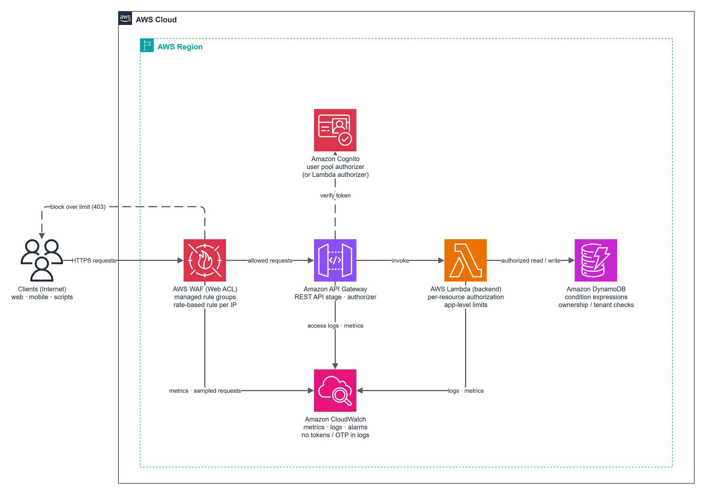

# API public không có nghĩa là ai muốn gọi bao nhiêu cũng được

**Đăng trên AWS Study Group:** [Xem bài viết gốc trên Facebook](https://www.facebook.com/groups/awsstudygroupfcj/posts/2339564356808523)

Một API public thì người dùng phải truy cập được từ Internet. Nhưng public không đồng nghĩa với việc backend phải nhận vô hạn request từ một client, một IP hay một nhóm request bất thường.

Hãy thử hình dung một endpoint đăng nhập hoặc gửi mã xác minh. Một client có thể gửi request liên tục, đội chi phí lên, làm nghẽn backend, hoặc khiến người dùng thật khó dùng dịch vụ. Nếu chỉ trông vào frontend để giới hạn số lần bấm, người khác vẫn có thể gọi thẳng vào API.

**Giải quyết thế nào?**

Có thể dựng một lớp bảo vệ ở biên như sau:

* Client gửi request đến Amazon API Gateway.
* AWS WAF được gắn vào API Gateway stage để đánh giá request theo Web ACL.
* WAF áp dụng các managed rule group phù hợp, cùng rate-based rule để giới hạn lưu lượng vượt ngưỡng trong một khoảng thời gian.
* API Gateway dùng authorizer phù hợp, chẳng hạn Amazon Cognito hoặc Lambda authorizer, để xác thực người dùng ở những endpoint cần đăng nhập.
* Backend Lambda tiếp tục kiểm tra quyền trên từng tài nguyên, vì xác thực thành công không thay thế được authorization.
* Amazon CloudWatch thu thập metric và log để theo dõi request bị chặn, lỗi và lưu lượng tăng bất thường.

**Rate limit không phải chiếc khiên tuyệt đối**

Rate-based rule của WAF chỉ là một lớp giảm thiểu, không phải lời hứa rằng mọi cuộc tấn công đều bị chặn. Ngưỡng quá thấp thì chặn nhầm người dùng thật, ngưỡng quá cao thì gần như vô dụng. Một IP cũng không phải lúc nào cũng tương ứng với một người, nhất là khi nhiều người dùng chung một mạng NAT.

Với các endpoint nhạy cảm như đăng nhập, gửi OTP hay khôi phục mật khẩu, nên kết hợp nhiều tín hiệu: IP, danh tính đã xác thực, hành vi theo từng tài khoản và giới hạn ở tầng ứng dụng. Ngoài ra, đừng ghi token, mật khẩu hay mã OTP vào log để phục vụ phân tích.

**Cần kiểm chứng điều gì?**

* Gửi request ở mức bình thường và xác nhận người dùng hợp lệ vẫn truy cập được.
* Tạo lưu lượng thử nghiệm vượt ngưỡng trong môi trường kiểm soát, xác nhận WAF bắt đầu áp dụng hành động đã cấu hình.
* Xem metric và log để phân biệt request được cho qua, bị WAF chặn và bị backend từ chối.
* Thử cho nhiều người dùng chung một IP để đánh giá nguy cơ chặn nhầm.
* Xác nhận endpoint yêu cầu đăng nhập vẫn từ chối request thiếu token hoặc có token không hợp lệ.
* Kiểm tra backend vẫn có authorization riêng, không coi WAF là cơ chế phân quyền dữ liệu.

WAF đứng ở cửa giúp bớt đi những người gây rối. Nhưng việc kiểm tra ai được vào phòng nào vẫn là của ứng dụng.

*Lưu ý: đây là kiến trúc và thiết kế kiểm thử đề xuất, chưa phải kết quả triển khai thực tế.*

#AWS #WAF #APIGateway #CloudSecurity #RateLimiting #CyberSecurity

