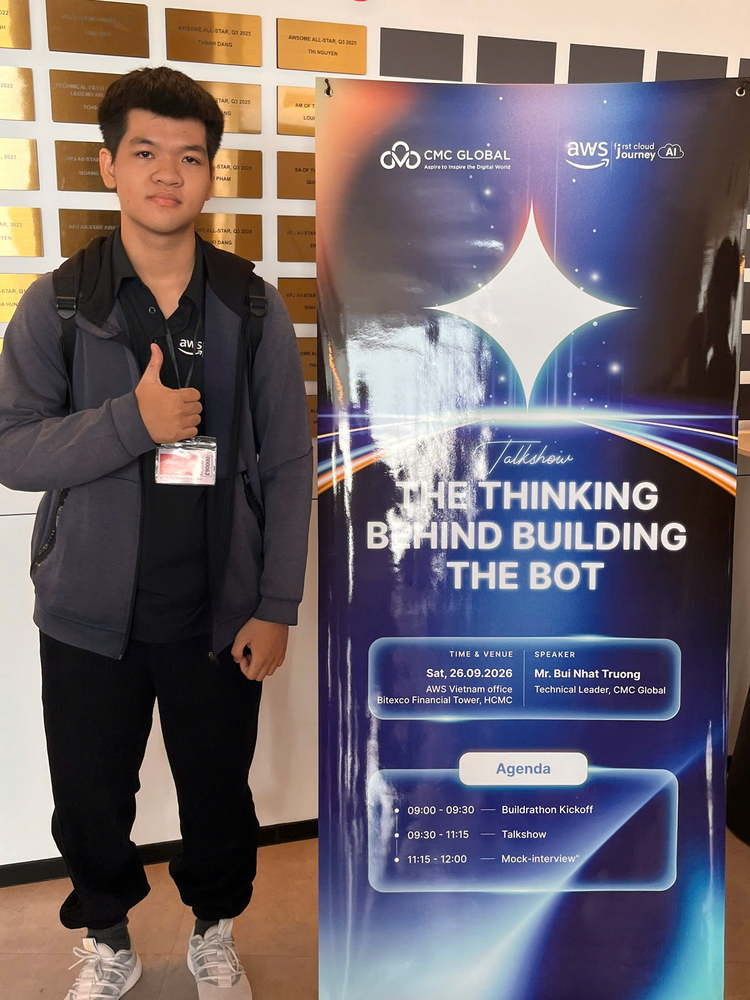
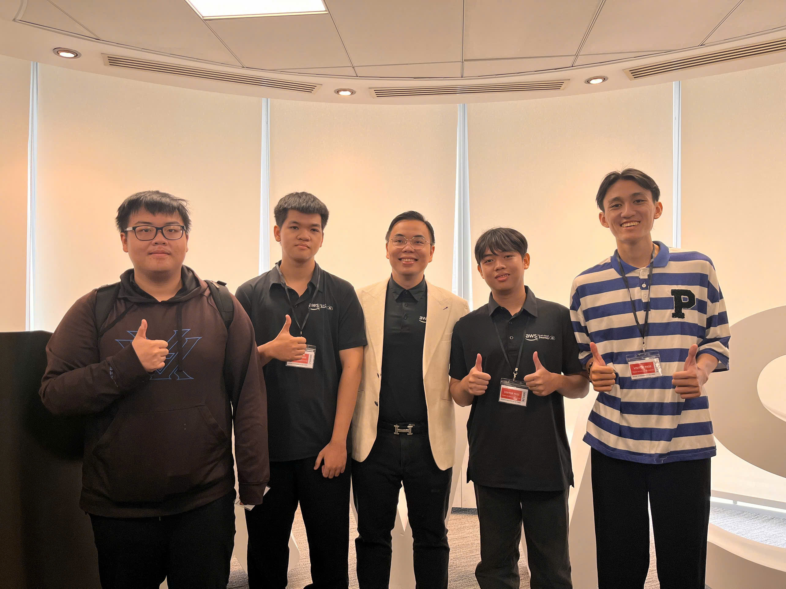

# **Event 1: Buildrathon – Kickoff: Code the Future with CMC Global**

**Date:** Saturday, 26/09/2026  
**Time:** 09:00 AM – 12:00 PM (GMT+7)  
**Location:** AWS Vietnam Office, 26th Floor, Bitexco Financial Tower, Ho Chi Minh City.  
**Role:** Participant  
**Event date:** [View on Facebook - AWS Study Group VN](https://www.facebook.com/groups/660548818043427/?multi_permalinks=2291343874963905)  

### **Event Objectives**

* Open the Buildrathon challenge for the FCAJ interns.  
* Encourage us to use Cloud & AI to build real products with our teammates, not only to learn them for the knowledge (the message on the event poster).  
* Let interns hear real work experience from a company in the industry.

### **Speakers**

* **Thien Lu** – Program Manager, FCAJ.  
* **Truong Bui** – Tech Lead, CMC Global.  
* **Phong Pham** – Program Manager, FCAJ.

### **Key Highlights**

#### **Opening of Buildrathon**
* The FCAJ program team opened Buildrathon and walked us through how the challenge works.

### **Event Experience**

This was my first event of the internship, in my second week, while I was still studying AWS on my own. After the kickoff, our team chose ReLoop, a marketplace for used and broken electronics, as our capstone project.

### **What Impressed Me Most: Sharing from Truong Bui (CMC Global)**

CMC Global has a team in Australia and developers in Vietnam. He shared how they connect the two sides through Slack so both can talk to each other directly, and the process they follow to handle those conversations and the bugs that come in through Slack.

**Key Takeaways:**

* Before moving the communication between two teams onto Slack, the AI agent first has to be trained to tell a minor bug from a serious one.  
* Beyond that, you have to think about how the agent supports both sides, so the two teams can understand each other easily.

### **Event Photos**

