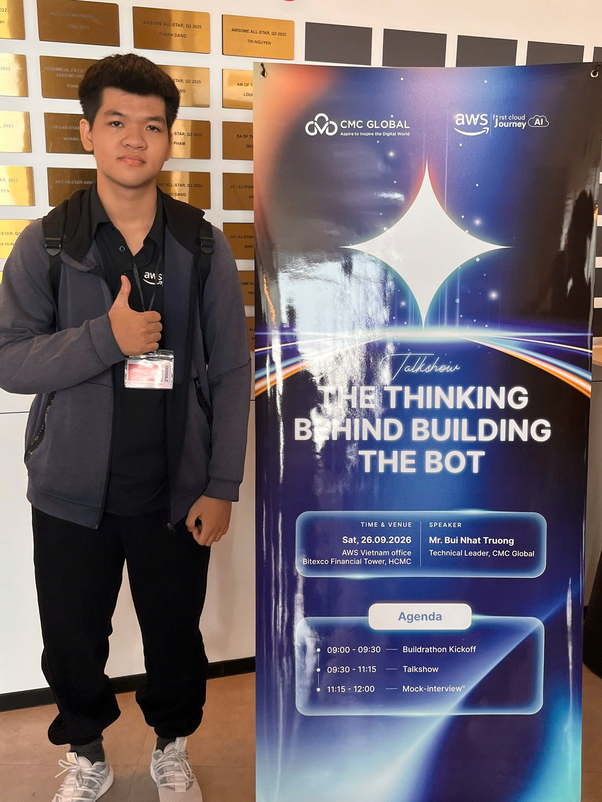
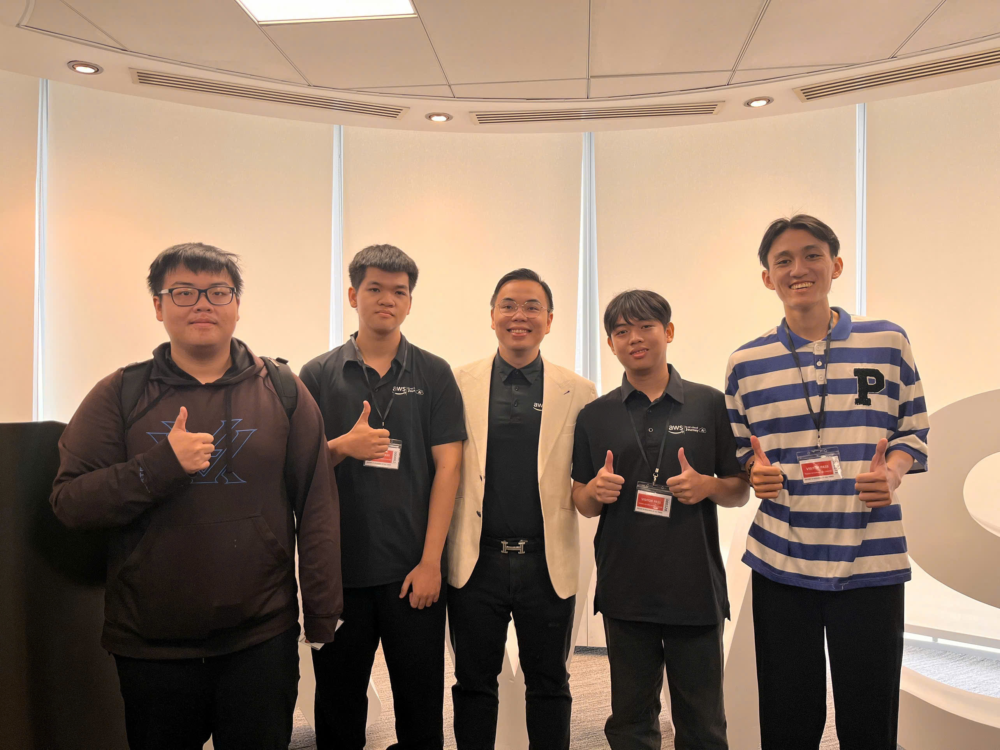

# **Sự kiện 1: Buildrathon – Khởi động: Kiến tạo tương lai cùng CMC Global**

**Ngày:** Thứ Bảy, 26/09/2026  
**Thời gian:** 09:00 – 12:00 (GMT+7)  
**Địa điểm:** Văn phòng AWS Việt Nam, Tầng 26, Bitexco Financial Tower, TP. Hồ Chí Minh.  
**Vai trò:** Người tham gia  
**Ngày sự kiện:** [Xem trên Facebook - AWS Study Group VN](https://www.facebook.com/groups/660548818043427/?multi_permalinks=2291343874963905)  

### **Mục tiêu sự kiện**

* Mở màn thử thách Buildrathon cho các bạn thực tập sinh FCAJ.  
* Khuyến khích dùng Cloud & AI để cùng đồng đội làm ra sản phẩm thật, không chỉ học để biết (thông điệp trên poster sự kiện).  
* Nghe chia sẻ kinh nghiệm làm việc thực tế từ doanh nghiệp.

### **Diễn giả**

* **Thien Lu** – Program Manager, FCAJ.  
* **Truong Bui** – Tech Lead, CMC Global.  
* **Phong Pham** – Program Manager, FCAJ.

### **Nội dung nổi bật**

#### **Mở màn Buildrathon**
* Đội ngũ chương trình FCAJ mở màn Buildrathon và giới thiệu cách thử thách diễn ra.

### **Trải nghiệm sự kiện**

Đây là sự kiện đầu tiên tôi tham gia trong kỳ thực tập, vào tuần thứ 2, khi tôi vẫn đang tự học AWS. Sau buổi khởi động, nhóm tôi chọn ReLoop, chợ mua bán đồ điện tử cũ và hỏng, làm đề tài capstone.

### **Ấn tượng nhất: phần chia sẻ của anh Truong Bui (CMC Global)**

CMC Global có đội ngũ bên Úc và các developer ở Việt Nam. Anh Truong chia sẻ cách kết nối hai bên qua Slack để có thể trao đổi trực tiếp với nhau, và quy trình xử lý các cuộc trò chuyện hay các bug được báo qua Slack.

**Bài học rút ra:**

* Muốn đưa việc trao đổi giữa hai team lên Slack thì trước hết cần huấn luyện AI Agent để nó phân biệt được lỗi nhẹ hay lỗi nặng khi xử lý.  
* Hơn thế nữa, cần tính đến việc AI Agent sẽ hỗ trợ hai bên như thế nào để hai team dễ hiểu nhau.

### **Hình ảnh sự kiện**

