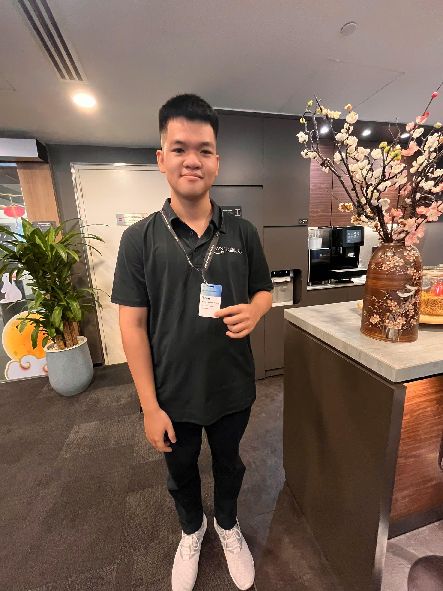

# **Event 2: AWS Cloud and AI Day Hanoi – Watch Party**

**Date:** Tuesday, 29/09/2026  
**Time:** 08:00 AM – 05:00 PM (GMT+7)  
**Location:** AWS Vietnam Office, 26th Floor, Bitexco Financial Tower, Ho Chi Minh City.  
**Role:** Attendee  
**Event date:** [View on Facebook - AWS Study Group VN](https://www.facebook.com/groups/660548818043427/?multi_permalinks=2292589671505992)  

### **Event Objectives**

* Let the builder community in Ho Chi Minh City watch AWS Cloud & AI Day 2026, held in Hanoi, live together.  
* Give builders, Solutions Architects and developers a place to sit down and discuss what they had just heard.  
* Connect the Cloud & AI community in the South. The Watch Party was organized by AWS Study Group together with AWS Vietnam.

### **Key Highlights**

#### **Keynote Streamed from Hanoi**
* On the big screen at the AWS office, we followed the talks from AWS leaders and experts. The three main topics were the Agentic AI wave, building a data foundation, and Cloud modernization for enterprises.

#### **Discussions on Site**
* During the breaks, people gathered in small roundtables to discuss how to move an AI agent from a trial into real operation and how to keep Cloud costs down.

### **Event Experience**

This was my second event, at the start of Week 3, the day after I first read the ReLoop specification. Unlike watching a livestream at home, people stayed to talk things through after each part, so I got to hear many more practical points of view.

### **Key Takeaways**

* Putting an AI agent into a real product is much harder than building a trial: cost and operation have to be planned from the start.  
* Settle the cost you can accept first, then choose the tool or service.

### **Event Photos**

