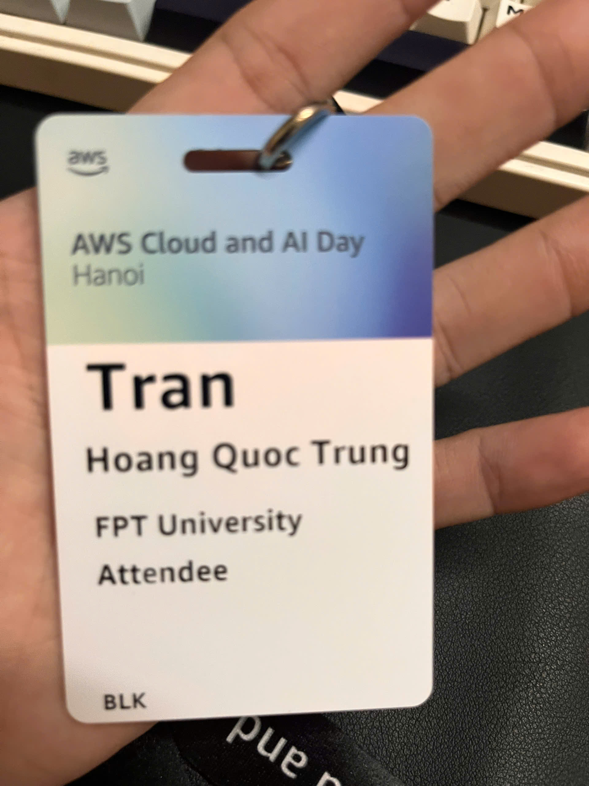
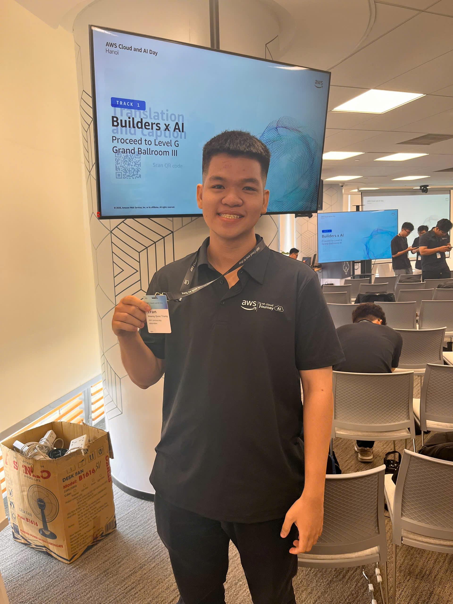

# **Event 2: AWS Cloud and AI Day Hanoi – Watch Party**

**Date:** Tuesday, September 29, 2026  
**Time:** 08:00 AM – 05:00 PM (GMT+7)  
**Location:** Amazon Web Services Vietnam Office, Level 26, Bitexco Financial Tower, Ho Chi Minh City, Vietnam.  
**Role:** Attendee  

### **Event Objectives**

* Present the latest advancements in AWS Cloud infrastructure and Enterprise AI.  
* Explore real-world enterprise modernization patterns using generative AI and Kubernetes.  
* Connect cloud builders, solution architects, and technology leaders across Vietnam.

### **Key Highlights**

#### **Agentic AI & Modern Software Engineering**
* Transition from passive chat interfaces to autonomous goal-driven AI Agents.

#### **Platform Engineering & Cloud Infrastructure**
* Internal Developer Platforms, Amazon EKS container orchestration, and multi-cluster deployment scalability.

#### **AI-Assisted Engineering Lifecycle**
* Enhancing developer velocity while rigorously managing latency, token costs, and operational reliability.

### **Key Takeaways & Application**

* Selecting the right architecture (FinOps and cost efficiency) is more critical than blindly choosing the newest tools.  
* Applied automated deployment workflows and CloudWatch log and error-alarm monitoring into our ReLoop development lifecycle.

### **Event Photos**

