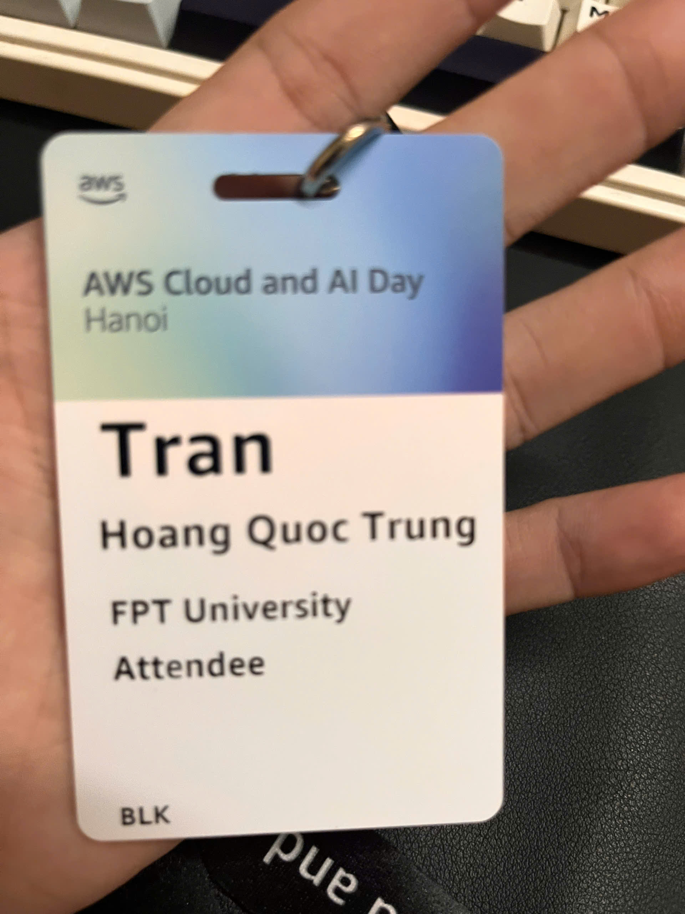
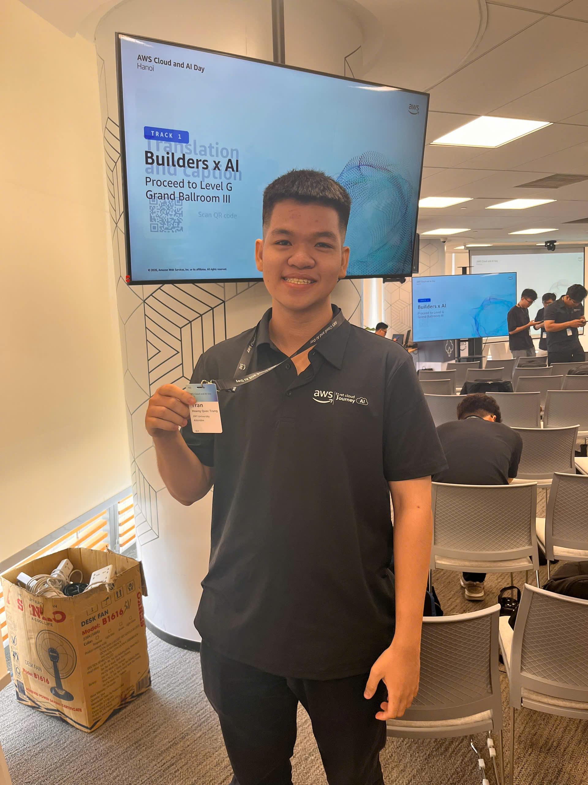
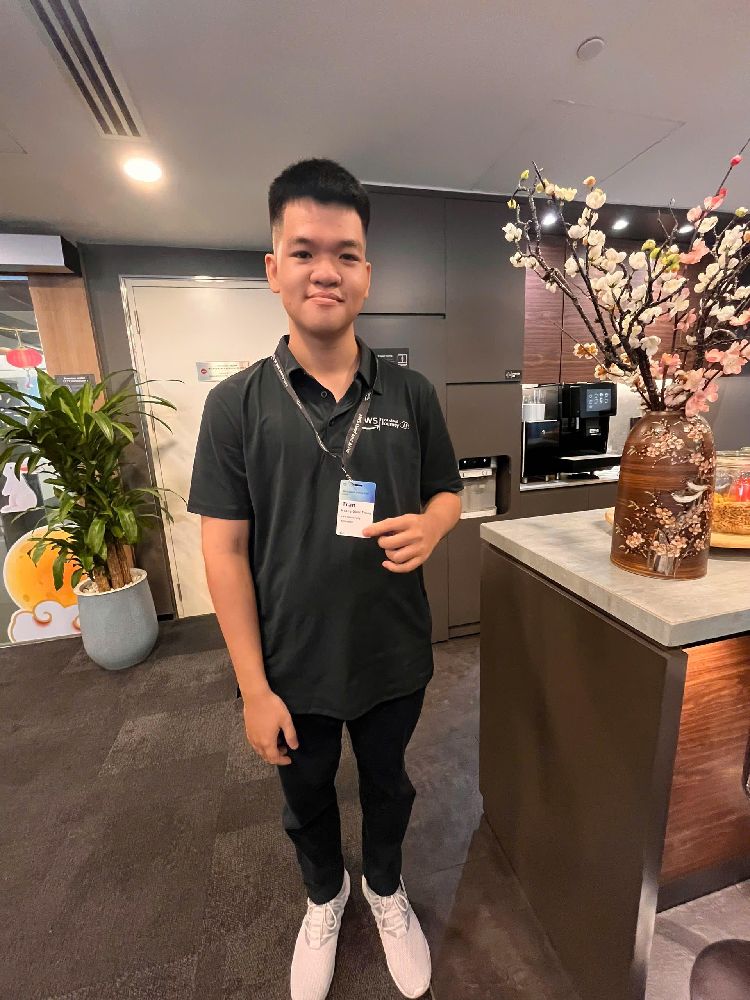

# **Sự kiện 2: AWS Cloud and AI Day Hanoi – Sự kiện Watch Party TP.HCM**

**Ngày:** Thứ Ba, 29/09/2026  
**Thời gian:** 08:00 – 17:00 (GMT+7)  
**Địa điểm:** Văn phòng AWS Việt Nam, Tầng 26, Bitexco Financial Tower, TP. Hồ Chí Minh.  
**Vai trò:** Người tham dự  
**Ngày sự kiện:** [Xem trên Facebook - AWS Study Group VN](https://www.facebook.com/groups/660548818043427/?multi_permalinks=2292589671505992)  

### **Mục tiêu sự kiện**

* Cho cộng đồng builder ở TP.HCM cùng xem trực tiếp AWS Cloud & AI Day 2026 đang diễn ra ở Hà Nội.  
* Tạo chỗ để builder, Solution Architect và developer ngồi lại thảo luận những gì vừa nghe.  
* Kết nối cộng đồng Cloud & AI phía Nam. Buổi Watch Party do AWS Study Group tổ chức cùng AWS Việt Nam.

### **Nội dung nổi bật**

#### **Xem Keynote truyền từ Hà Nội**
* Cả phòng theo dõi qua màn hình lớn ở văn phòng AWS phần chia sẻ của lãnh đạo AWS và các chuyên gia. Ba chủ đề chính là làn sóng Agentic AI, xây dựng nền tảng dữ liệu (Data Foundation) và hiện đại hóa Cloud cho doanh nghiệp.

#### **Thảo luận tại chỗ**
* Trong giờ nghỉ, mọi người ngồi thành từng bàn tròn để bàn về cách đưa AI Agent từ bản thử nghiệm vào vận hành thật và cách tối ưu chi phí trên Cloud.

### **Trải nghiệm sự kiện**

Đây là sự kiện thứ hai tôi tham gia, vào đầu tuần 3, ngay sau hôm tôi đọc đặc tả ReLoop lần đầu. Khác với xem livestream ở nhà, sau mỗi phần mọi người còn ngồi lại trao đổi với nhau, nên tôi được nghe thêm nhiều góc nhìn thực tế.

### **Bài học rút ra**

* Đưa AI Agent vào sản phẩm thật khó hơn nhiều so với làm bản thử: phải tính đến chi phí và cách vận hành ngay từ đầu.  
* Nên chốt mức chi phí chấp nhận được trước, rồi mới chọn công cụ hay dịch vụ.

### **Hình ảnh sự kiện**

