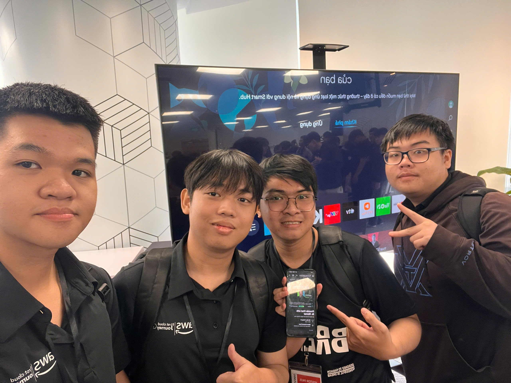

# **Event 3: Fireside Chat with Dr. Werner – Navigating the Future of Cloud & AI in Vietnam**

**Date:** Friday, 02/10/2026  
**Time:** 10:30 AM – 12:00 PM (GMT+7)  
**Location:** AWS Vietnam Office, 26th Floor, Bitexco Financial Tower, Ho Chi Minh City.  
**Role:** Attendee  
**Event Video:** [View On YouTube - AWS Study Group Channel](https://www.youtube.com/watch?v=jWjOIfMA9qc)  

### **Event Objectives**

* Hear Dr. Werner Vogels talk about the road ahead for Cloud and AI in Vietnam.  
* Learn how AWS builds and runs very large distributed systems, from the person in charge of Amazon's technology.  
* Understand how the work of a software engineer is changing now that AI is here.

### **Speaker**

* **Dr. Werner Vogels** – CTO, Amazon.

### **Key Highlights**

#### **Where AWS Started**
* The story of how AWS began and grew, from serving small startups to global enterprises.  
* The original idea: infrastructure has to be reliable, and builders should be able to use it on their own without waiting for anyone to provision it.

#### **Running Systems at Large Scale**
* With huge numbers of users and requests, reliability, automation and horizontal scaling have to be planned from the design stage, not left for later.

#### **The "Renaissance Developer"**
* An engineer in the AI era needs solid computer science fundamentals and also knows how to use AI to work at a higher level.

#### **AI Makes Prototypes Fast, but the Engineer Is Still Responsible**
* AI greatly shortens the time from an idea to a working prototype.  
* Even when AI writes the code, the engineer is still the one responsible for its quality, its correctness and the architecture choices.

### **Event Experience**

This session came at the end of Week 3, the same day I took the Backend Engineer role in the ReLoop team. Hearing Amazon's CTO tell how AWS started, and talk about the developer's role now that AI is here, was a very rare chance for me.

### **Key Takeaways**

* AI makes things faster, but what AI produces still has to be checked before it goes into a real system. Later, when I tested image-analysis AI for ReLoop, I also checked each answer against the real photo before choosing Kimi K3.  
* Working with AI makes the fundamentals even more important: you have to understand the system to tell whether the AI got it right.  
* Design so the system can grow, but stay close to the real needs and do not build more than required.

### **Event Photos**

