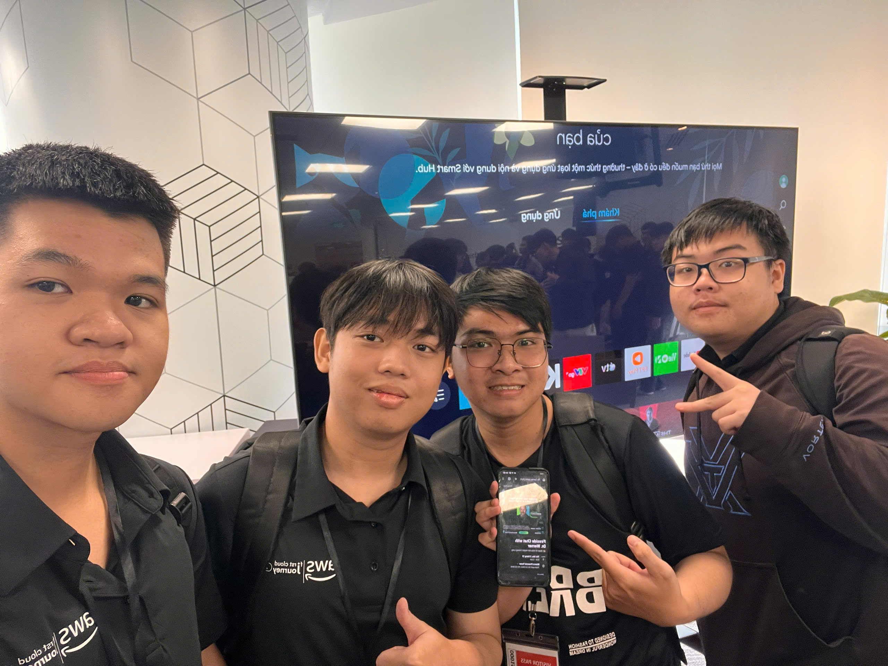

# **Sự kiện 3: Trò chuyện thân mật cùng TS. Werner Vogels – Định hình tương lai Điện toán đám mây & AI tại Việt Nam**

**Ngày:** Thứ Sáu, 02/10/2026  
**Thời gian:** 10:30 – 12:00 (GMT+7)  
**Địa điểm:** Văn phòng AWS Việt Nam, Tầng 26, Bitexco Financial Tower, TP. Hồ Chí Minh.  
**Vai trò:** Người tham dự  
**Video sự kiện:** [Xem trên YouTube - Kênh AWS Study Group](https://www.youtube.com/watch?v=jWjOIfMA9qc)  

### **Mục tiêu sự kiện**

* Nghe Dr. Werner Vogels nói về chặng đường phía trước của Cloud và AI tại Việt Nam.  
* Học cách AWS xây dựng và vận hành những hệ thống phân tán rất lớn, từ chính người phụ trách công nghệ của Amazon.  
* Hiểu công việc của kỹ sư phần mềm đang thay đổi thế nào khi có AI.

### **Diễn giả**

* **Dr. Werner Vogels** – CTO, Amazon.

### **Nội dung nổi bật**

#### **AWS bắt đầu từ đâu**
* Câu chuyện AWS ra đời rồi lớn dần, từ phục vụ các startup nhỏ đến các doanh nghiệp toàn cầu.  
* Ý tưởng gốc: hạ tầng phải đủ tin cậy và để builder tự dùng được mà không phải chờ ai cấp phát.

#### **Vận hành hệ thống ở quy mô lớn**
* Khi lượng người dùng và request rất lớn, độ tin cậy, tự động hóa và khả năng mở rộng theo chiều ngang phải được tính ngay từ lúc thiết kế, không để dành về sau.

#### **"Renaissance Developer"**
* Kỹ sư thời AI vừa cần nền tảng khoa học máy tính vững, vừa biết dùng AI để làm việc ở tầng cao hơn.

#### **AI làm prototype nhanh, nhưng kỹ sư vẫn chịu trách nhiệm**
* AI rút ngắn rất nhiều thời gian từ ý tưởng đến bản chạy thử.  
* Dù code do AI viết, người chịu trách nhiệm về chất lượng, tính đúng đắn và các lựa chọn kiến trúc vẫn là kỹ sư.

### **Trải nghiệm sự kiện**

Buổi này rơi vào cuối tuần 3, cũng là hôm tôi nhận vai trò Backend Engineer trong nhóm ReLoop. Được nghe trực tiếp CTO của Amazon kể lại AWS bắt đầu thế nào và nói về vai trò của developer khi có AI là một cơ hội rất hiếm với tôi.

### **Bài học rút ra**

* AI giúp làm nhanh, nhưng kết quả AI đưa ra vẫn phải được kiểm tra trước khi vào hệ thống thật. Sau này khi tự test AI phân tích ảnh cho ReLoop, tôi cũng đối chiếu từng câu trả lời với ảnh thật trước khi chọn Kimi K3.  
* Làm việc cùng AI thì kiến thức nền càng quan trọng: phải hiểu hệ thống mới biết AI làm đúng hay sai.  
* Thiết kế để hệ thống lớn lên được, nhưng vẫn bám vào nhu cầu thực tế, không làm quá mức cần.

### **Hình ảnh sự kiện**

