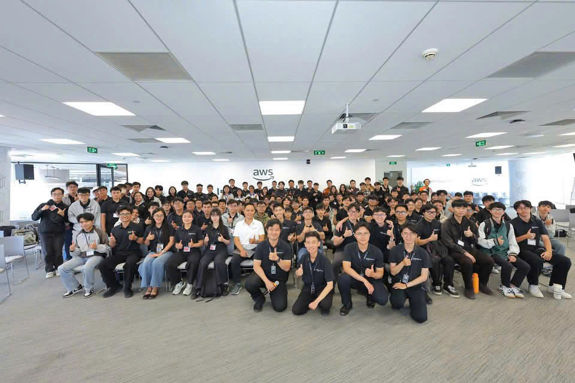
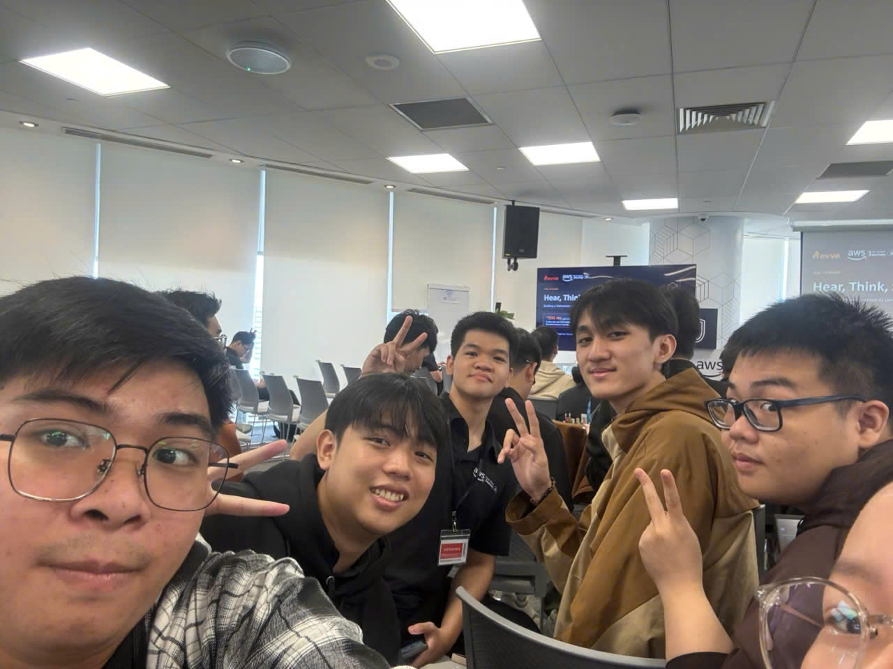

# **Event 4: Cloud & AI Infrastructure Meetup**

**Date:** Saturday, 24/10/2026  
**Time:** 10:30 AM – 12:00 PM (GMT+7)  
**Location:** AWS Vietnam Office, 26th Floor, Bitexco Financial Tower, Ho Chi Minh City.  
**Role:** Attendee  

### **Event Objectives**

* Hear Tech Leads and working engineers share how they build Cloud systems and put AI agents into real use.  
* Learn how to keep things secure across many AWS accounts and how to keep infrastructure costs reasonable.  
* Meet people from the AWS Student Builder Group and engineers already working in the field.

### **Speakers**

| Speaker | Role | Session |
| :--- | :--- | :--- |
| **Kiet Tran** | Revve AI | Session 1: Hear, Think, Speak – Vietnamese Voice AI for contact centers on AWS |
| **Long Huynh** | STYL Solutions | Session 2: AWS Resource Access Manager (RAM) |
| **Thinh Nguyen** | STYL Solutions | Session 3: Pentest on AWS with Security Agent |
| **Xuan An** | Leader, AWS Student Builder Group HCMUTE | Session 4: Amazon Bedrock AgentCore |
| **Khoa Kieu** | Tech Lead, ACB | Session 5: Kiro Crew – a 24/7 AI agent for code review and system monitoring |
| **Nghi Danh** | AWS Community Builder | — |

### **Key Highlights**

#### **Session 1 – Vietnamese Voice AI for Contact Centers (Revve AI)**
* Each step of the pipeline was tuned so the spoken reply comes back in about 1.8 seconds, fast enough for the conversation to feel natural.  
* Live demo: a Vietnamese-speaking agent interviewed someone applying for a Cloud Engineer job and asked follow-up questions based on the answers.

#### **Session 2 – AWS Resource Access Manager (RAM)**
* Share networks and resources between accounts in AWS Organizations, so the same thing is not rebuilt in every account and can be managed in one place.  
* Combine IAM policies with SCPs (Service Control Policies) to set permission limits, so nobody can raise their own permissions by accident.

#### **Session 3 – Pentest on AWS with Security Agent**
* "Shift-Left": check Terraform code for security issues inside the GitHub/GitLab pull request, before it is merged.  
* A Security Agent acts like a real user and runs pentests on the SIT/UAT environment before the release goes to production.

#### **Session 4 – Amazon Bedrock AgentCore**
* Run agent runtimes in isolated MicroVMs on EC2 Spot instances to lower compute cost.  
* Split agent memory into two layers, short-term session memory (synchronous) and long-term user memory (asynchronous), so answers stay in context.

#### **Session 5 – Kiro Crew: a 24/7 AI Agent for Code Review and System Monitoring**
* An always-on agent reviews code, watches the system and draws charts right inside the chat window.  
* Keep the context small: compress the chat history when it is about 70–90% full (Auto Compact), see which part uses the tokens (Break Down Context), and use Guardrails to block commands that would break infrastructure or leak credentials.

### **Event Experience**

The meetup came at the end of Week 6, while I was building the background timers for ReLoop. Five talks in a row made it a dense morning. It opened with Revve AI's Voice AI demo interviewing a candidate in Vietnamese, and the other talks went into the problems companies face when running real systems: security across many accounts, pentesting, agent memory, and keeping an agent safe while it runs 24/7.

### **Key Takeaways**

* Every AI system has to balance latency, security and cost: Voice AI has to answer fast, while an agent that runs 24/7 has to account for token and compute costs.  
* Security should start early and come in layers: scan Terraform inside the pull request, limit permissions with IAM plus SCPs, and set Guardrails so an agent cannot run dangerous commands.  
* The Security Agent pentest talk was the closest to my Cybersecurity major, and it is also the service I tried on my own outside the project.

### **Event Photos**

