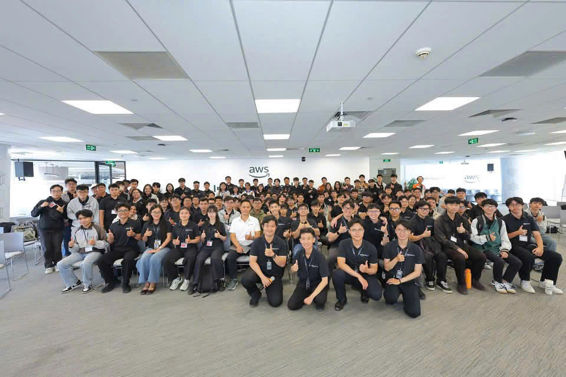
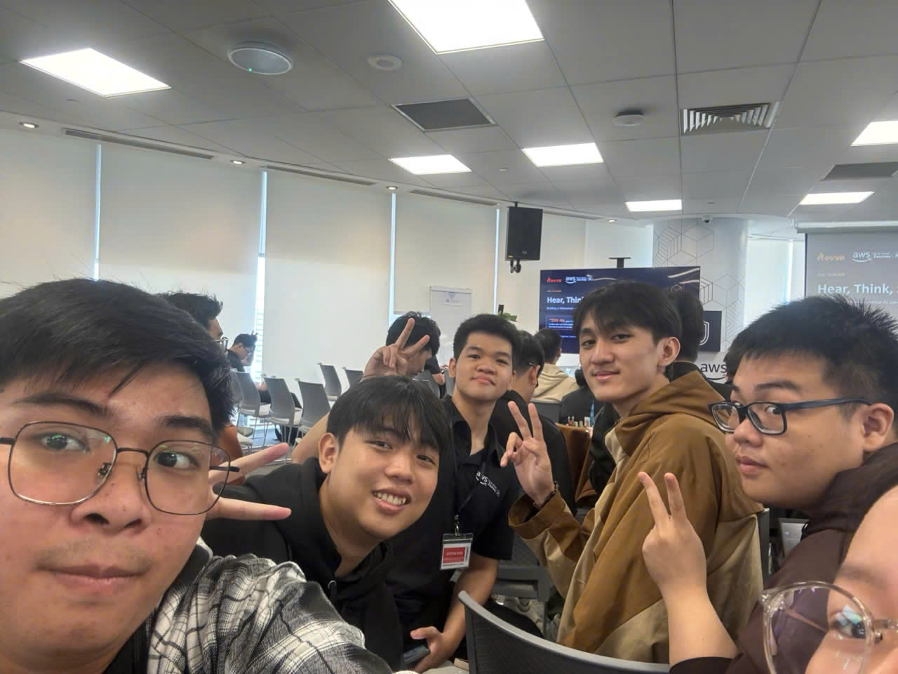

# **Sự kiện 4: Hội thảo chuyên sâu về Hạ tầng Điện toán đám mây & AI (Cloud & AI Infrastructure Meetup)**

**Ngày:** Thứ Bảy, 24/10/2026  
**Thời gian:** 10:30 – 12:00 (GMT+7)  
**Địa điểm:** Văn phòng AWS Việt Nam, Tầng 26, Bitexco Financial Tower, TP. Hồ Chí Minh.  
**Vai trò:** Người tham dự  

### **Mục tiêu sự kiện**

* Nghe các Tech Lead và kỹ sư đang đi làm chia sẻ cách họ dựng hệ thống Cloud và đưa AI Agent vào chạy thật.  
* Tìm hiểu cách bảo mật khi dùng nhiều tài khoản AWS và cách giữ chi phí hạ tầng ở mức hợp lý.  
* Giao lưu với cộng đồng AWS Student Builder Group và những người đang làm nghề.

### **Diễn giả**

| Diễn giả | Vai trò | Phần trình bày |
| :--- | :--- | :--- |
| **Kiet Tran** | Revve AI | Session 1: Hear, Think, Speak – Voice AI tiếng Việt cho tổng đài trên AWS |
| **Long Huynh** | STYL Solutions | Session 2: AWS Resource Access Manager (RAM) |
| **Thinh Nguyen** | STYL Solutions | Session 3: Pentest trên AWS với Security Agent |
| **Xuan An** | Leader, AWS Student Builder Group HCMUTE | Session 4: Amazon Bedrock AgentCore |
| **Khoa Kieu** | Tech Lead, ACB | Session 5: Kiro Crew – AI Agent 24/7 cho code review và giám sát hệ thống |
| **Nghi Danh** | AWS Community Builder | — |

### **Nội dung nổi bật**

#### **Session 1 – Voice AI tiếng Việt cho tổng đài (Revve AI)**
* Tối ưu từng bước trong pipeline để thời gian phản hồi bằng giọng nói còn khoảng 1,8 giây, đủ nhanh để cuộc nói chuyện nghe tự nhiên.  
* Demo trực tiếp: một agent nói tiếng Việt tự phỏng vấn sàng lọc ứng viên Cloud Engineer và hỏi tiếp dựa trên câu trả lời của ứng viên.

#### **Session 2 – AWS Resource Access Manager (RAM)**
* Chia sẻ mạng và tài nguyên giữa nhiều tài khoản trong AWS Organizations, để không phải tạo trùng ở từng tài khoản và quản lý được ở một chỗ.  
* Dùng IAM policy cùng Service Control Policy (SCP) để đặt giới hạn quyền, tránh việc ai đó tự nâng quyền ngoài ý muốn.

#### **Session 3 – Pentest trên AWS với Security Agent**
* "Shift-Left": kiểm tra bảo mật code Terraform ngay trong pull request trên GitHub/GitLab, trước khi merge.  
* Security Agent tự đóng vai người dùng thật để chạy pentest ở môi trường SIT/UAT trước khi đưa lên production.

#### **Session 4 – Amazon Bedrock AgentCore**
* Chạy runtime của agent trong MicroVM cách ly trên EC2 Spot để giảm chi phí tính toán.  
* Chia bộ nhớ của agent thành hai lớp: bộ nhớ ngắn hạn của phiên (đồng bộ) và bộ nhớ dài hạn của người dùng (bất đồng bộ), để câu trả lời luôn đúng ngữ cảnh.

#### **Session 5 – Kiro Crew: AI Agent 24/7 cho code review và giám sát hệ thống**
* Agent chạy liên tục để review code, theo dõi hệ thống và vẽ biểu đồ ngay trong khung chat.  
* Giữ context gọn: tự nén lịch sử hội thoại khi đầy khoảng 70–90% (Auto Compact), xem token đang tốn ở phần nào (Break Down Context), và dùng Guardrails để chặn lệnh phá hạ tầng hoặc làm lộ thông tin đăng nhập.

### **Trải nghiệm sự kiện**

Buổi meetup rơi vào cuối tuần 6, lúc tôi đang làm phần timer chạy nền cho ReLoop. Năm phần chia sẻ liên tiếp nên lượng kiến thức khá dày. Mở đầu là demo Voice AI của Revve AI phỏng vấn ứng viên bằng tiếng Việt, sau đó các phần còn lại đi vào những chuyện doanh nghiệp gặp khi chạy hệ thống thật: bảo mật nhiều tài khoản, pentest, bộ nhớ cho agent và giữ cho agent chạy 24/7 một cách an toàn.

### **Bài học rút ra**

* Hệ thống AI nào cũng phải cân giữa độ trễ, bảo mật và chi phí: Voice AI cần phản hồi nhanh, còn agent chạy 24/7 thì phải tính tiền token và tiền máy.  
* Bảo mật nên làm sớm và nhiều lớp: quét Terraform ngay trong pull request, giới hạn quyền bằng IAM kết hợp SCP, và đặt Guardrails để agent không chạy được lệnh nguy hiểm.  
* Phần pentest bằng Security Agent là phần gần với ngành An toàn thông tin của tôi nhất, và đây cũng là dịch vụ tôi tự thử thêm ngoài dự án.

### **Hình ảnh sự kiện**

