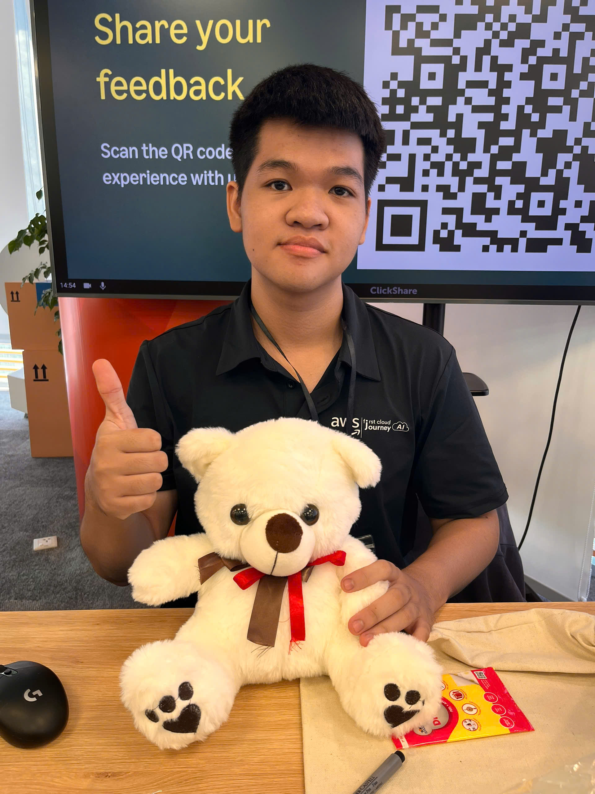
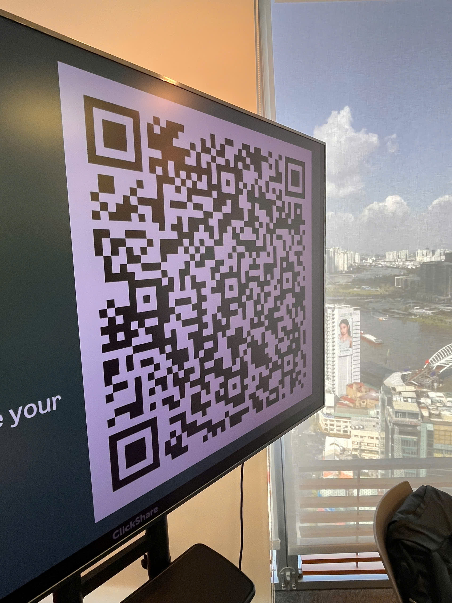

# **Event 5: Smart Plushies for Children – In Collaboration with Operation Smile Vietnam**

**Date:** Monday, October 26, 2026  
**Time:** 01:30 PM – 03:30 PM (GMT+7)  
**Location:** EC2 Room, Level 36, AWS Vietnam Office, Bitexco Financial Tower, Ho Chi Minh City, Vietnam.  
**Role:** Participant  

### **Event Objectives**

* Use technology and creativity for a good cause.  
* Build and program smart plush toys, with sensors and sound, for children being treated in hospital.  
* Work with Operation Smile Vietnam to bring some joy to those children.

### **Key Highlights**

#### **Technology for the Community**
* Technical skills mean more when they are used to help other people.

#### **Building Together**
* We fitted the sensors, set up the sound responses and finished the plushies together with the other participants.

### **Event Experience**

This workshop felt very different from the Cloud sessions I usually attended. It reminded me that technology is most worth it when it makes people's lives better, and here that meant bringing a smile to sick children. Finishing a plushie with my own hands for the children was a really happy feeling too.

### **Event Photos**

