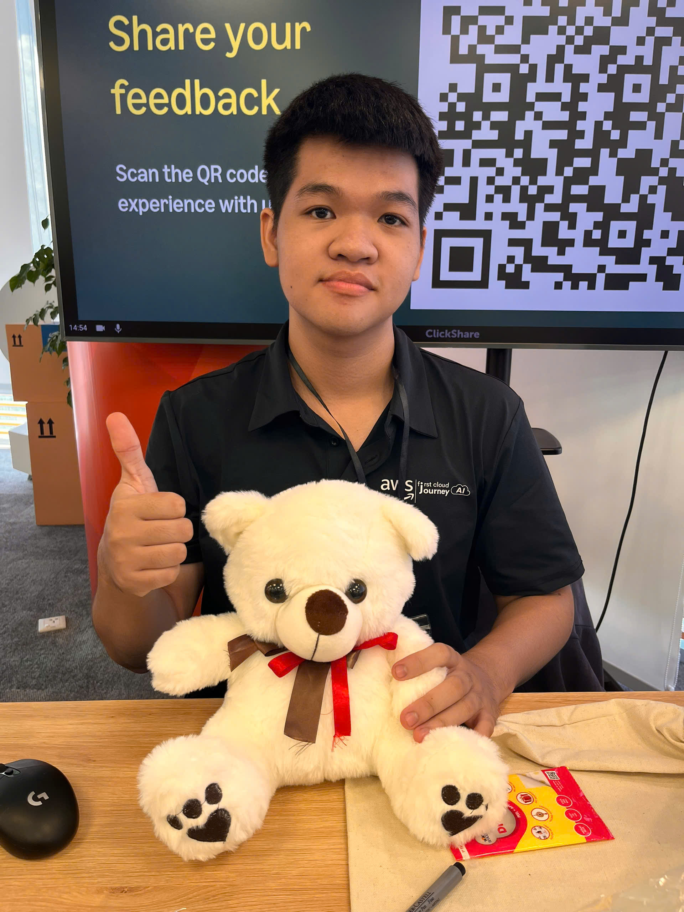
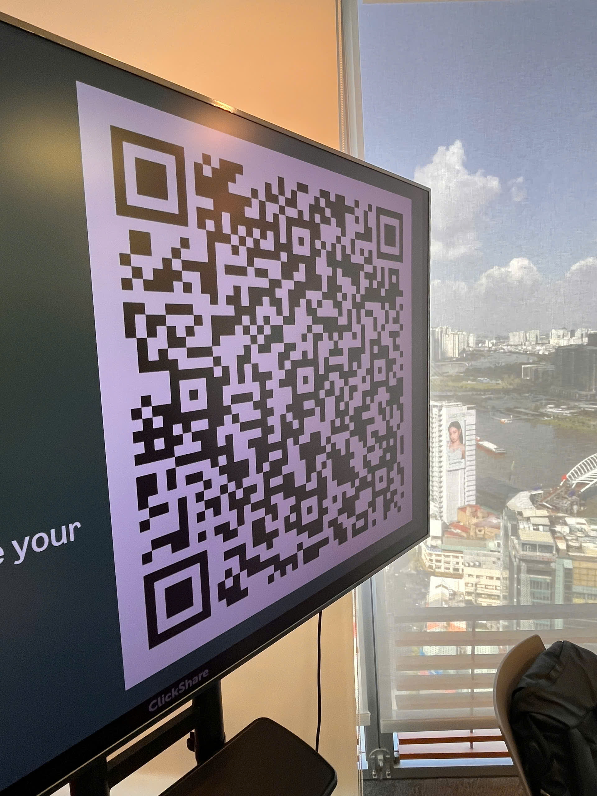

# **Sự kiện 5: Gấu bông thông minh cho trẻ em – Hoạt động vì cộng đồng phối hợp cùng Operation Smile Vietnam**

**Ngày:** Thứ Hai, ngày 26 tháng 10 năm 2026  
**Thời gian:** 13:30 – 15:30 (GMT+7)  
**Địa điểm:** Phòng EC2, Tầng 36, Văn phòng AWS Việt Nam, Bitexco Financial Tower, TP. Hồ Chí Minh.  
**Vai trò:** Người tham gia  

### **Mục tiêu sự kiện**

* Dùng công nghệ và sự sáng tạo cho một việc có ích.  
* Lắp ráp và lập trình gấu bông thông minh, có cảm biến và phát âm thanh, dành cho các bé đang điều trị ở bệnh viện.  
* Cùng Operation Smile Vietnam mang lại niềm vui cho các bé.

### **Nội dung nổi bật**

#### **Công nghệ cho cộng đồng**
* Kỹ năng kỹ thuật có ý nghĩa hơn khi được dùng để giúp người khác.

#### **Cùng nhau lắp ráp**
* Gắn cảm biến, cài phần phát âm thanh và cùng các bạn khác hoàn thiện chú gấu bông.

### **Trải nghiệm sự kiện**

Buổi này khác hẳn những buổi chia sẻ về Cloud mà tôi thường tham gia. Nó nhắc tôi rằng công nghệ đáng giá nhất khi giúp cuộc sống con người tốt hơn, như ở đây là mang lại nụ cười cho các bé đang bị bệnh. Tự tay làm xong một chú gấu bông để gửi tới các bé cũng là một cảm giác rất vui.

### **Hình ảnh sự kiện**

