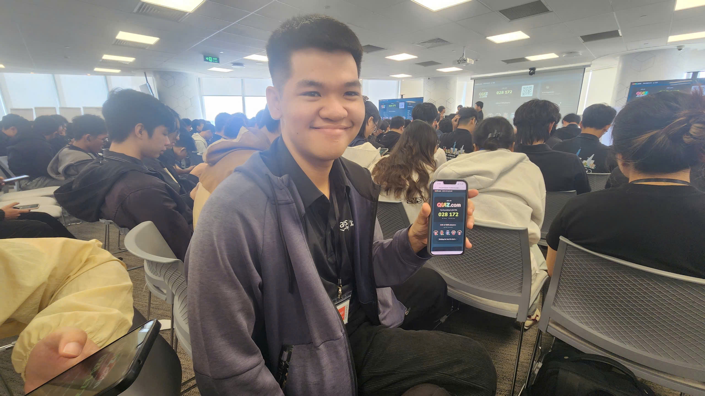

# **Event 6: Cloud Mastery – Cloud Sharing Session for Students**

**Date:** Saturday, November 14, 2026  
**Time:** Morning (GMT+7)  
**Location:** AWS Vietnam Office, Level 26, Bitexco Financial Tower, Ho Chi Minh City, Vietnam.  
**Role:** Attendee  

### **Event Objectives**

* Show students how to learn Cloud in a practical way.  
* Answer students' own questions about technical basics, the skills they need and the path to a Cloud job.  
* Give students who like technology a place to meet, talk and study side by side.

### **Key Highlights**

#### **Cloud Knowledge and Career Direction**
* Suggested a learning path and the skills to focus on first when starting with Cloud.  
* Talked about the career paths in Cloud, based on the questions the attendees asked.

#### **Q&A with Students**
* The questions were about getting stuck as a beginner, which project to build, and how to go deeper technically.  
* People kept asking and following up, so the Q&A ran a lot longer than planned.

#### **Closing Quiz and the Next Event**
* At the end of the morning, more than 100 players joined a live Quiz to go over what we had heard.  
* The organizers introduced AWS Student Community Day Vietnam 2026, taking place on 23/11/2026.

### **Event Experience**

Saturday morning, 14/11, at the AWS office felt relaxed and friendly. Watching students ask question after question in the Q&A, and playing the closing quiz with more than 100 others, gave me a moment to look back at my own FCAJ path: from studying AWS on my own in the first weeks to building the backend for ReLoop.

### **Key Takeaways**

* Cloud fundamentals only really pay off when you also build real projects and pay attention to security.  
* Asking questions and sharing with friends and mentors helps you learn faster and see more clearly which way you want to go.  
* The session helped me look back at the Cloud and security skills I have after the internship, see what I still need to learn, and made me want to keep joining AWS community events.

### **Event Photos**

