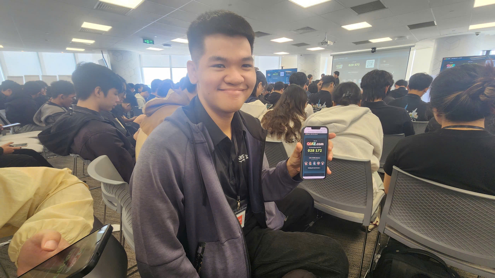

# **Sự kiện 6: Cloud Mastery – Buổi chia sẻ về Cloud cho sinh viên**

**Ngày:** Thứ Bảy, ngày 14 tháng 11 năm 2026  
**Thời gian:** Buổi sáng (GMT+7)  
**Địa điểm:** Văn phòng AWS Việt Nam, Tầng 26, Bitexco Financial Tower, TP. Hồ Chí Minh.  
**Vai trò:** Người tham dự  

### **Mục tiêu sự kiện**

* Chia sẻ với sinh viên cách học Cloud sao cho thực tế.  
* Trả lời trực tiếp các câu hỏi của sinh viên về nền tảng kỹ thuật, kỹ năng cần có và con đường đi làm Cloud.  
* Tạo chỗ để các bạn sinh viên thích công nghệ gặp nhau, trao đổi và học cùng nhau.

### **Nội dung nổi bật**

#### **Chia sẻ kiến thức Cloud và định hướng nghề nghiệp**
* Gợi ý lộ trình học và những kỹ năng nên ưu tiên khi mới bắt đầu với Cloud.  
* Nói về các hướng đi nghề nghiệp trong ngành Cloud, dựa trên chính câu hỏi của người tham dự.

#### **Hỏi đáp với sinh viên**
* Các câu hỏi xoay quanh chuyện bị "kẹt" lúc mới học, nên chọn dự án nào để làm, và làm sao để hiểu sâu hơn về kỹ thuật.  
* Mọi người hỏi nhiều và hỏi tiếp liên tục nên phần hỏi đáp kéo dài vượt xa thời gian ban đầu.

#### **Quiz cuối buổi và sự kiện sắp tới**
* Buổi sáng kết thúc bằng một game Quiz trực tiếp với hơn 100 người chơi để ôn lại nội dung.  
* Cuối buổi có thông báo về AWS Student Community Day Vietnam 2026, diễn ra ngày 23/11/2026.

### **Trải nghiệm sự kiện**

Sáng thứ Bảy 14/11 ở văn phòng AWS là một buổi rất thoải mái và gần gũi. Nhìn các bạn sinh viên hỏi liên tục trong phần hỏi đáp và cùng hơn 100 người chơi Quiz cuối buổi, tôi có dịp nhìn lại chặng đường của mình trong FCAJ: từ tự học AWS ở những tuần đầu đến làm backend cho ReLoop.

### **Bài học rút ra**

* Nền tảng Cloud chỉ thật sự có giá trị khi đi cùng dự án thực tế và ý thức về bảo mật.  
* Chủ động hỏi và trao đổi với bạn bè, mentor giúp mình học nhanh hơn và biết rõ mình muốn đi hướng nào.  
* Buổi này giúp tôi nhìn lại những kỹ năng Cloud và bảo mật đã có sau kỳ thực tập, thấy rõ chỗ cần học thêm, và muốn tiếp tục tham gia cộng đồng AWS.

### **Hình ảnh sự kiện**

